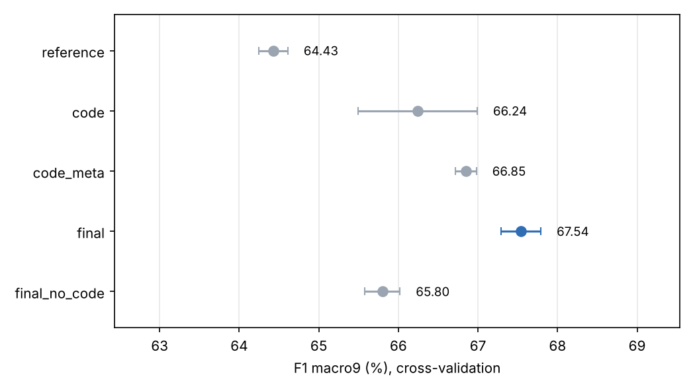
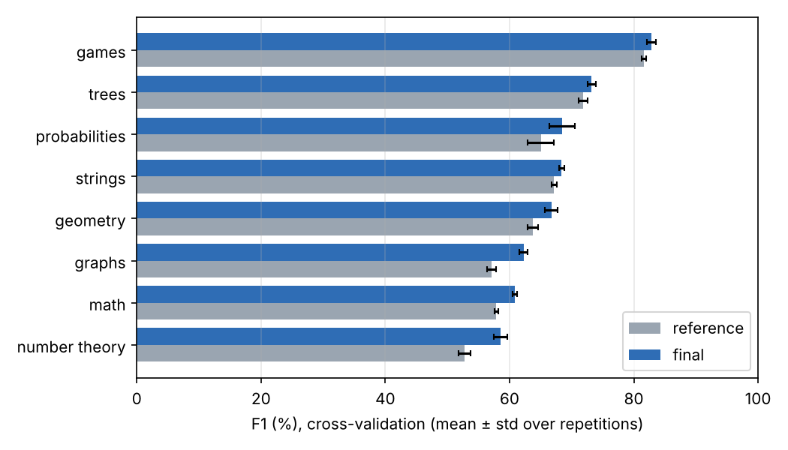
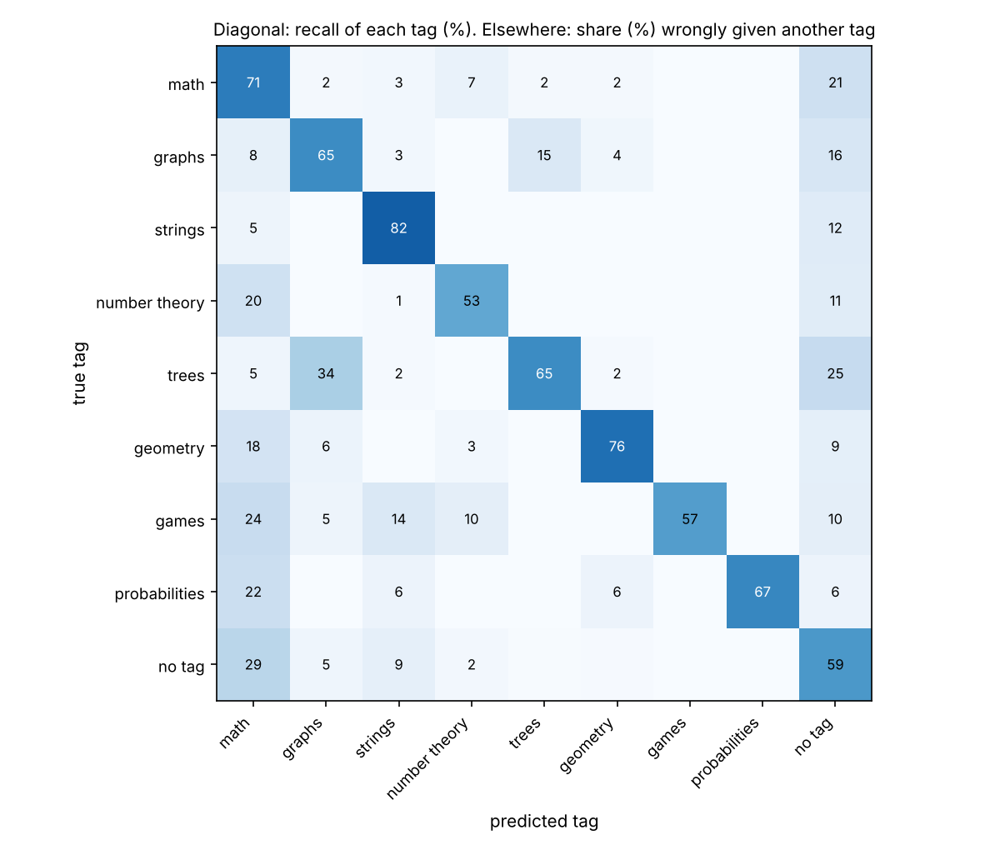

# Algorithm tags

Prédire les tags algorithmiques d'un problème de programmation compétitive à partir de son énoncé, de sa solution Python, de sa difficulté et de ses exemples d'entrée et de sortie.

Les données sont 4 982 problèmes Codeforces issus de [xCodeEval](https://arxiv.org/abs/2303.03004). Huit tags sont visés : `math`, `graphs`, `strings`, `number theory`, `trees`, `geometry`, `games`, `probabilities`. Un problème peut en avoir plusieurs, ou aucun : c'est le cas de 2 304 problèmes (46 %), qui sont gardés car le modèle rencontrera aussi ce cas en usage réel.

## Protocole et métriques

Scores en %, écarts en points de pourcentage.

- **Split** : train / validation / test = 2 981 / 997 / 1 004 problèmes (60 / 20 / 20), stratification multilabel itérative avec une colonne « aucun tag » (`data/splits/splits.csv`). Le test n'a servi à aucune décision.
- **Validation croisée** : sur train + validation (3 978 problèmes), KFold 5 plis répété 4 fois (graines 0 à 3), mêmes plis pour tous les modèles. ± = écart-type entre les 4 répétitions.
- **F1 macro8** : moyenne non pondérée des F1 des 8 tags.
- **F1 macro9** : moyenne non pondérée de 9 F1, les 8 tags plus l'état « aucun tag » (les 8 sorties négatives), traité comme une 9e classe. Il pénalise un modèle qui tague les 46 % de problèmes hors périmètre. **C'est le critère de sélection.**
- **Fausses alertes** : problèmes sans aucun des 8 tags qui en reçoivent au moins un.

## Résultats

Le modèle retenu, `final`, est composé de huit SVM linéaires (binary relevance, un par tag) sur six blocs de features, avec un seuil de décision commun. Il est comparé au modèle `reference` : un `LinearSVC` par tag (C = 1) sur le seul bloc `words`, avec la même règle de seuil.

### Scores globaux

| | `reference` | `final` |
|---|---:|---:|
| **F1 macro9**, validation croisée | 64,43 ± 0,18 | **67,54 ± 0,25** |
| F1 macro8, validation croisée | 64,64 ± 0,18 | 67,66 ± 0,23 |
| F1 micro, validation croisée | 60,87 ± 0,25 | 64,04 ± 0,17 |
| F1 « aucun tag », validation croisée | 62,74 ± 0,36 | 66,58 ± 0,76 |
| Exact match, validation croisée | 50,95 ± 0,46 | 54,36 ± 0,60 |
| F1 macro9, validation (entraîné sur train) | 64,66 | 67,41 |
| F1 macro9, test (entraîné sur train) | 64,63 | 65,65 |
| Fausses alertes, test (sur 461 problèmes sans tag) | 209 | 187 |

Le modèle final gagne 3,1 points de F1 macro9 en validation croisée, et il est devant à chacune des 4 répétitions. Sur le test seul, l'écart est de 1,0 point, pour un intervalle de confiance à 95 % d'environ ±2,5 points (bootstrap) : c'est pourquoi les choix ont été faits en validation croisée.



### Par tag

Validation croisée, du tag le mieux prédit au moins bien prédit. Le gain est en points de F1.

| Tag | Précision | Rappel | F1 `final` | F1 `reference` | Gain |
|---|---:|---:|---:|---:|---:|
| games | 82,4 | 83,3 | **82,8** | 81,6 | +1,2 |
| trees | 71,7 | 74,8 | **73,2** | 71,9 | +1,4 |
| probabilities | 74,8 | 63,2 | **68,5** | 65,1 | +3,4 |
| strings | 59,6 | 80,3 | **68,4** | 67,2 | +1,2 |
| geometry | 67,3 | 66,2 | **66,7** | 63,7 | +3,0 |
| graphs | 58,8 | 66,1 | **62,3** | 57,1 | +5,2 |
| math | 54,5 | 69,0 | **60,9** | 57,9 | +3,0 |
| number theory | 59,6 | 57,6 | **58,6** | 52,8 | +5,8 |



Ce qu'il faut en retenir :

- `games` et `trees` sont les mieux prédits : leur vocabulaire est très spécifique (« player », « optimally », « tree », « root »).
- `number theory`, `math` et `graphs` sont les plus difficiles. Ce sont aussi ceux qui recoupent le plus d'autres tags : 75 % des problèmes `number theory` sont aussi `math`, et 38 % des problèmes `trees` sont aussi `graphs`.
- Les plus gros gains viennent du code de la solution pour `number theory` (+5,8) et `graphs` (+5,2), avec des indices comme `gcd`, `%`, `visited`, `queue`. Pour `probabilities` (+3,4), ils viennent des exemples : 42 % de ces problèmes attendent une réponse décimale, contre 3 % des autres.
- `probabilities` n'a que 74 problèmes dans train + validation : son F1 varie d'environ 2 points d'une répétition à l'autre.

Matrice de confusion entre tags (test). Ligne : vrai tag. Diagonale : rappel. Hors diagonale : part des problèmes de la ligne qui reçoivent le tag de la colonne alors qu'ils ne l'ont pas ; les co-tags corrects ne sont pas comptés. Colonne « no tag » : aucun tag prédit.



Les deux confusions principales sont attendues : 34 % des problèmes `trees` reçoivent `graphs` alors qu'ils ne l'ont pas, et 20 % des problèmes `number theory` reçoivent `math` alors qu'ils ne l'ont pas. Ces frontières sont déjà floues dans les annotations. Les matrices 2×2 par tag sont dans le même dossier ([`confusion_per_tag.png`](results/test_final/confusion_per_tag.png)), et les features les plus influentes par tag sont dans [docs/top_features.md](docs/top_features.md).

## Démarche

L'objectif était de trouver ce qui fait vraiment progresser le score, puis de garder la solution la plus simple qui l'obtient.

1. **Explorer les données** ([notebook](notebooks/01_exploration.ipynb)). Près de la moitié des problèmes n'a aucun tag, deux tags sont rares, plusieurs tags se recoupent, la difficulté change la répartition des tags et les exemples trahissent certains tags. Chaque constat a donné un choix de modélisation (métrique F1 macro9, `class_weight="balanced"`, blocs `difficulty` et `samples`).
2. **Choisir la famille de modèle sur l'énoncé seul.** TF-IDF avec régression logistique ou SVM, CNN avec plusieurs embeddings, encodeurs pré-entraînés, classification zéro-shot et petit LLM local. Le SVM linéaire sur TF-IDF est le meilleur, et le plus simple. Il devient la référence.
3. **Ajouter de l'information, pas de la complexité.** Le code de la solution, sa structure, la difficulté et les exemples sont ajoutés un par un, chacun comme un bloc séparé. Chaque étape est mesurée (tableau ci-dessus). C'est là que se fait le gain de 3 points.
4. **Vérifier qu'un modèle plus complexe ne fait pas mieux sur ces mêmes features.** Environ 130 variantes ont été essayées : autres classifieurs, LightGBM, MLP, plus proches voisins, lexiques par tag, stacking, seuils par tag, embeddings de code et de texte gelés. Aucune ne dépasse le modèle retenu d'un écart qui justifie sa complexité.

Le détail des comparaisons est dans [docs/approaches.md](docs/approaches.md).

### Le modèle

| Bloc | Contenu | Poids |
|---|---|---:|
| `words` | TF-IDF mots 1-2 grammes de l'énoncé (description, entrée, sortie, notes), 30k termes max | 1,0 |
| `chars` | TF-IDF caractères 3-5 grammes (`char_wb`) de l'énoncé, 60k termes max | 0,5 |
| `code` | TF-IDF mots 1-2 grammes de la solution, lignes d'I/O récurrentes retirées, 20k termes max | 0,5 |
| `ast` | TF-IDF 1-2 grammes de jetons de l'AST Python : types de nœuds, fonctions appelées, imports, opérateurs, 20k termes max | 0,3 |
| `difficulty` | rating Codeforces et paliers (8 valeurs) | 0,25 |
| `samples` | 11 indices tirés des exemples : réponse décimale, lignes « u v », noms de joueurs, modulo, etc. | 0,25 |

TF-IDF avec `min_df=2` et `sublinear_tf`, normalisé L2 par bloc ; blocs denses standardisés. Chaque bloc est multiplié par son poids avant concaténation (117 113 colonnes au total pour le modèle entraîné sur train).

- **Classifieur** : un `LinearSVC` par tag, C = 0,5, `class_weight="balanced"`. Les sorties sont des marges (`decision_function`), non calibrées.
- **Décision** : un tag est prédit si sa marge atteint un seuil global, choisi pour maximiser le F1 macro9 sur les marges out-of-fold (3 plis) du train. Le modèle est ensuite réentraîné sur tout le train.
- **Pas de fuite** : vocabulaires, standardisation et seuil sont appris dans chaque pli, sur sa seule partie entraînement. Les tags ne servent jamais d'entrée.
- **Sans solution disponible** : la variante `final_no_code` atteint 65,80 de F1 macro9, encore 1,4 point au-dessus de la référence.

Pourquoi un modèle linéaire : sur 4 000 problèmes annotés, un SVM sur TF-IDF est un lexique pondéré complet appris sur les données. Il s'entraîne en une minute sur un CPU, prédit en quelques millisecondes et chaque décision s'explique par ses features.

## Installation

Python 3.11 ou plus récent, aucun GPU.

```bash
git clone https://github.com/charbel-dib/algorithm-tags.git && cd algorithm-tags
python -m venv .venv
source .venv/bin/activate              # Windows : .venv\Scripts\Activate.ps1
python -m pip install -r requirements.txt -e ".[split,dev]"
```

`requirements.txt` fixe les versions exactes utilisées pour les résultats. Extras : `split` (régénérer un split), `dev` (linter), `notebooks` (pandas, Jupyter).

## Utilisation

Le seul chemin à donner est celui des données brutes : un dossier de JSON xCodeEval, un seul JSON ou un fichier JSONL. Toutes les autres commandes ont des chemins par défaut.

```bash
# 1. Lire et valider les JSON bruts -> data/processed/problems.jsonl (2 s)
python -m algo_tags preprocess --raw chemin/vers/les/json

# 2. Entraîner le modèle final sur train -> models/final.joblib + models/final.json (1 min)
python -m algo_tags train

# 3. Scores globaux et par tag, matrices de confusion sur la partie test -> results/test_final/
python -m algo_tags evaluate --on test

# 4. Tags d'un nouveau problème (JSON brut, dossier ou JSONL)
python -m algo_tags predict --input examples/problem.json

# 5. Features les plus influentes pour chaque tag
python -m algo_tags explain
```

Réponse de `predict` (un tag est prédit quand sa marge est au moins égale au seuil ; marges et seuil varient légèrement selon la machine d'entraînement) :

```json
{
  "src_uid": "591372383cf3624f69793c41370022de",
  "tags": ["math"],
  "margins": {"math": -0.031, "graphs": -1.039, "strings": -1.407, "number theory": -0.867,
              "trees": -0.854, "geometry": -1.283, "games": -1.053, "probabilities": -1.405},
  "threshold": -0.1762,
  "latency_ms": 17.0
}
```

`evaluate` réécrit les fichiers de `results/` fournis avec le dépôt : `git diff results/` montre alors l'écart avec les résultats publiés (voir « Reproductibilité » plus bas).

Autres usages :

```bash
# Entraîner un autre modèle de l'ablation (reference, code, code_meta, final, final_no_code)
python -m algo_tags train --model reference
python -m algo_tags evaluate --model models/reference.joblib --on validation

# Entraîner sur train + validation avant une évaluation finale sur test
python -m algo_tags train --train-on train validation --output models/final_full.joblib

# Prédire un lot de problèmes et écrire une ligne JSON par problème
python -m algo_tags predict --input chemin/vers/les/json --output runs/predictions.jsonl

# Comparer des modèles en validation croisée -> results/cv/ (environ 1 h sur 2 cœurs)
python -m algo_tags cv --models reference code code_meta final final_no_code

# Construire un nouveau split stratifié (par défaut 60/20/20, comme le split de référence fourni)
python -m algo_tags split --output data/splits/my_split.csv --seed 0
python -m algo_tags split --output data/splits/split_70_15_15.csv --test-size 0.15 --validation-size 0.15
python -m algo_tags train --splits data/splits/split_70_15_15.csv
python -m algo_tags evaluate --model models/final.joblib --splits data/splits/split_70_15_15.csv --on test
```

`python -m algo_tags <commande> --help` décrit toutes les options. Une fois le paquet installé, `algo-tags` remplace `python -m algo_tags`.

## Mise en production

- **Bibliothèque** : le modèle s'utilise directement depuis Python, sur un JSON brut.

  ```python
  from algo_tags import TagModel

  model = TagModel.load("models/final.joblib")
  model.tag(raw_problem)   # {"tags": [...], "margins": {...}, "threshold": ..., "latency_ms": ...}
  ```

- **Docker** : l'image installe les versions exactes et lance la ligne de commande avec un utilisateur non root.

  ```bash
  docker build -t algo-tags .
  docker run --rm -v "$PWD/models:/app/models" -v "$PWD/examples:/app/examples" \
      algo-tags predict --input examples/problem.json
  ```

  Sous PowerShell, la commande tient sur une ligne (le `\` final est propre à bash) :

  ```powershell
  docker run --rm -v "${PWD}/models:/app/models" -v "${PWD}/examples:/app/examples" algo-tags predict --input examples/problem.json
  ```

- **Logs** : chaque commande écrit dans la console et dans `logs/algo_tags.log` (rotation à 2 Mo, 3 archives) : version, commande lancée, taille des données, durée de chaque étape, latence par problème. Exemple :

  ```text
  2026-10-24 20:22:16,014 INFO    algo_tags.model | predicted 997 problems in 3.44 s (3.4 ms per problem)
  2026-10-24 20:25:41,872 INFO    algo_tags.model | model final loaded from models/final.joblib in 0.55 s
  ```

- **Traçabilité** : chaque modèle est sauvé avec une fiche JSON (`models/final.json`) : blocs, seuil, nombre de problèmes et de features, F1 macro9 hors pli, durée d'entraînement, date et versions des bibliothèques. Un avertissement est émis si le modèle est chargé avec une autre version de scikit-learn.
- **Validation des entrées** : un problème sans description est refusé avec un message clair. Les autres champs sont facultatifs, et le champ `tags` est ignoré à la prédiction.
- **Coût** : modèle de 12 Mo, chargement en 0,6 s, 17 ms pour un problème isolé, 3,4 ms par problème en lot, entraînement en 70 s sur un CPU.
- **Tests** : 23 tests unitaires sur données synthétiques, de la lecture des JSON à la ligne de commande, lancés à chaque push par GitHub Actions.

```bash
python -m unittest discover -s tests
ruff check .
```

Les fichiers `.joblib` ne doivent être chargés que s'ils viennent d'une source de confiance, comme tout fichier pickle.

## Reproductibilité

Les chiffres de ce README ont été obtenus sous Linux avec les versions de `requirements.txt` ; deux exécutions sur une même machine donnent les mêmes chiffres. D'une machine à l'autre, les scores sur un seul split bougent de quelques dixièmes. Sous Windows, avec les mêmes données et versions : `final` 67,18 en validation et 66,42 en test (seuil −0,157), `reference` 64,92 en test.

Cause : `max_features` coupe le vocabulaire à fréquence égale. Pour `words`, 6 260 termes sont à égalité à la limite des 30 000 et 946 sont gardés ; scikit-learn les départage avec un tri non stable, dont l'ordre peut dépendre de la machine. La validation croisée est stable (67,52 sous Windows, 67,54 sous Linux).

## Structure

```text
src/algo_tags/
    data.py        lecture des JSON bruts, préparation, split
    features.py    les six blocs de features
    model.py       les huit SVM, le seuil, sauvegarde et chargement
    metrics.py     F1 par tag, F1 macro8 et macro9, confusion entre tags
    plots.py       figures des résultats
    cv.py          validation croisée répétée
    split.py       stratification multilabel
    log.py         logs console et fichier, mesure des durées
    __main__.py    ligne de commande
tests/             tests unitaires
results/           résultats cités dans ce README (cv/ : validation croisée ; validation_* et test_* : parties du split)
docs/              approches comparées, features les plus influentes
notebooks/         exploration du corpus
data/              split de référence (les JSON bruts ne sont pas versionnés)
examples/          un problème du test au format brut, sans ses tags
```

## Limites et suites possibles

- Les annotations sont bruitées : des programmeurs expérimentés ne retrouvent qu'une partie des tags d'un problème Codeforces ([Athavale et al., 2019](https://arxiv.org/abs/1903.00830)). Une partie des erreurs sur `math` vient de là.
- Le modèle suppose une solution Python. Sans solution, utiliser `final_no_code`.
- Les marges ne sont pas des probabilités. Si un score de confiance calibré est nécessaire, il faut ajouter une calibration.
- Pistes non réalisées : fine-tuning d'un encodeur texte et code, plusieurs solutions par problème, plus de données annotées, audit des annotations de `math`. Elles sont détaillées dans [docs/approaches.md](docs/approaches.md).

La version précédente du dépôt (modèles sur l'énoncé seul) reste disponible sous le tag `v1.0.0`.
