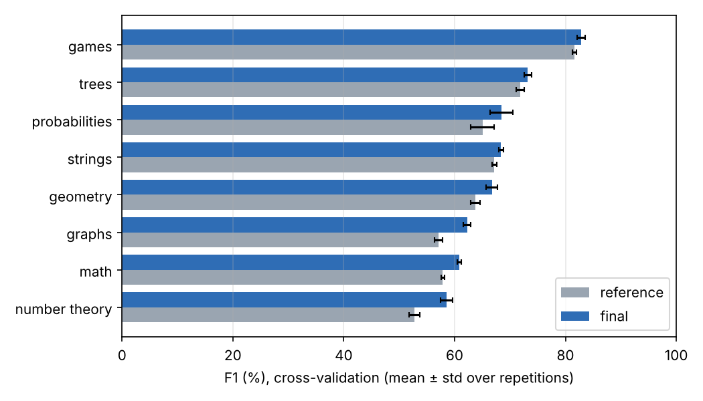

# Algorithm tags

Prédire les tags algorithmiques d'un problème Codeforces ([xCodeEval](https://arxiv.org/abs/2303.03004)) à partir de son énoncé, de sa solution Python, de sa difficulté et de ses exemples. Classification **multilabel** sur 8 tags : `math`, `graphs`, `strings`, `number theory`, `trees`, `geometry`, `games`, `probabilities`. Un problème peut avoir plusieurs tags ou aucun : c'est le cas de 2 304 problèmes sur 4 982.

## Résultats

**Modèle retenu (`final`)** : huit SVM linéaires (un par tag) sur six blocs de features, avec un seuil de décision global.

### Global

Validation croisée 5 plis répétée 4 fois sur train + validation (3 978 problèmes) : moyenne ± écart-type entre répétitions. Le split d'origine (train → validation / test) est donné en complément.

| | Référence (énoncé seul) | **Modèle final** |
|---|---:|---:|
| **F1 macro9**, validation croisée | 64,43 ± 0,18 | **67,54 ± 0,25** |
| F1 macro8, validation croisée | 64,64 ± 0,18 | 67,66 ± 0,23 |
| F1 micro, validation croisée | 60,87 ± 0,25 | 64,04 ± 0,17 |
| F1 « aucun tag », validation croisée | 62,74 ± 0,36 | 66,58 ± 0,76 |
| Exact match, validation croisée | 50,95 ± 0,46 | 54,36 ± 0,60 |
| F1 macro9, validation (997) | 64,66 | 67,41 |
| F1 macro9, test (1 004) | 64,63 | 65,65 |
| Fausses alertes sur les problèmes sans tag, test | 209 / 461 | 187 / 461 |

Le modèle final gagne **+3,1 points de macro9** en validation croisée, et le gain est positif à chacune des 4 répétitions. Sur le seul test, le gain est plus faible (+1,0) : un écart mesuré sur un split de 1 000 problèmes reste très bruité (intervalle de confiance à 95 % d'environ ±2,5 points par bootstrap), c'est pourquoi la validation croisée répétée sert de critère de choix. Le test n'a servi à aucune décision.

**Métriques.** F1 macro8 = moyenne des F1 des 8 tags, chaque tag pesant autant, même rare. F1 macro9 = macro8 + le F1 de l'état « aucun tag » (les 8 sorties négatives), qui pénalise les tags prédits à tort sur les problèmes hors périmètre. Macro9 est le critère de sélection.

### Par tag

Validation croisée, modèle final. Tags triés du mieux au moins bien prédit.

| Tag | Précision | Rappel | **F1** | F1 référence | Gain | Support |
|---|---:|---:|---:|---:|---:|---:|
| games | 82,4 | 83,3 | **82,8** | 81,6 | +1,2 | 84 |
| trees | 71,7 | 74,8 | **73,2** | 71,9 | +1,4 | 259 |
| probabilities | 74,8 | 63,2 | **68,5** | 65,1 | +3,4 | 74 |
| strings | 59,6 | 80,3 | **68,4** | 67,2 | +1,2 | 338 |
| geometry | 67,3 | 66,2 | **66,7** | 63,7 | +3,0 | 133 |
| graphs | 58,8 | 66,1 | **62,3** | 57,1 | +5,2 | 434 |
| math | 54,5 | 69,0 | **60,9** | 57,9 | +3,0 | 1 126 |
| number theory | 59,6 | 57,6 | **58,6** | 52,8 | +5,8 | 280 |



- **Les mieux prédits** : `games` et `trees`. Leur vocabulaire est spécifique (« player », « optimally », « tree », « root »).
- **Les plus difficiles** : `number theory`, `math` et `graphs`. `math` est le tag le plus fréquent (28 %) et le plus large : ses features les plus pondérées décrivent des contraintes génériques (« le 10 », « 5 5 ») plutôt que des notions précises, et `number theory` le recoupe. `graphs` et `trees` se confondent : 38 % des problèmes `trees` sont aussi tagués `graphs`, et sur le test, 22 des 49 faux positifs `graphs` sont des problèmes `trees`.
- **Les plus gros gains** : `number theory` (+5,8) et `graphs` (+5,2) grâce au code de la solution (`gcd`, `%`, `visited`, `queue`), et `probabilities` (+3,4) grâce aux exemples (réponses réelles).
- `probabilities` n'a que 74 exemples positifs : son F1 varie de 2 points d'une répétition à l'autre.

Les features qui pèsent le plus pour chaque tag sont dans [docs/top_features.md](docs/top_features.md).

## Méthode

| Bloc | Contenu | Poids |
|---|---|---:|
| `words` | TF-IDF mots 1–2-grammes de l'énoncé (description, entrée, sortie, notes) | 1,0 |
| `chars` | TF-IDF n-grammes de caractères 3–5 de l'énoncé | 0,5 |
| `code` | TF-IDF mots 1–2-grammes de la solution, lignes d'I/O récurrentes retirées | 0,5 |
| `ast` | TF-IDF de la structure de la solution (arbre syntaxique Python) : types de nœuds, fonctions appelées, modules importés, opérateurs | 0,3 |
| `difficulty` | rating Codeforces et paliers de difficulté | 0,25 |
| `samples` | 11 indices tirés des exemples : réponses réelles, lignes « u v », noms de joueurs, modulo… | 0,25 |

- **Classifieur** : un `LinearSVC` par tag (C = 0,5, classes équilibrées). Les scores sont des marges, pas des probabilités.
- **Décision** : un seuil global sur les marges, choisi pour maximiser macro9 sur des prédictions hors pli (3 plis) des données d'entraînement, puis le modèle est réentraîné sur toutes ces données.
- **Sans fuite** : vocabulaires, normalisations et seuil sont appris uniquement sur les données d'entraînement de chaque pli. Les tags ne servent jamais d'entrée.
- **Sans solution disponible** : la variante `final_no_code` atteint 65,80 de macro9 en validation croisée.

Pourquoi ce modèle : les CNN, encodeurs pré-entraînés, LLM zéro-shot, LightGBM, MLP, kNN, lexiques par tag et stacking ont été testés sans dépasser le SVM linéaire. Le gain vient des informations ajoutées, pas d'un modèle plus complexe. Voir [docs/approaches.md](docs/approaches.md) pour toutes les comparaisons et les pistes d'amélioration.

## Reproduire

Python 3.11+. Aucun GPU.

```bash
python -m venv .venv
source .venv/bin/activate          # Windows : .venv\Scripts\Activate.ps1
python -m pip install -e .
```

Placer les 4 982 JSON dans `data/raw/` (voir [data/README.md](data/README.md)). Le split `data/splits/splits.csv` est fourni.

```bash
# Comparaison en validation croisée -> results/cv_global.csv, cv_per_tag.csv, cv_per_tag_f1.png (~1 h sur 2 cœurs)
python -m algo_tags cv --data data/raw --models reference code code_meta final final_no_code

# Entraîner le modèle final sur train (~2 min)
python -m algo_tags train --data data/raw --model final --output models/final.joblib

# Scores globaux et par tag sur validation ou test
python -m algo_tags evaluate --model models/final.joblib --data data/raw --on test

# Tags d'un problème (JSON brut, un seul fichier ou un dossier) -> tags, marges, seuil (~1 s)
python -m algo_tags predict --model models/final.joblib --input examples/problem.json

# Features les plus influentes par tag
python -m algo_tags explain --model models/final.joblib
```

`--model reference` reproduit le modèle de la v1. `train --train-on train validation` entraîne sur train + validation avant une évaluation finale sur test.

## Structure

```
src/algo_tags/   data.py (lecture des JSON, split) · features.py (6 blocs) · model.py (SVM + seuil)
                 metrics.py (F1 par tag, macro8/9) · cv.py (validation croisée) · split.py · __main__.py (CLI)
tests/           tests unitaires sur données synthétiques (python -m unittest discover -s tests)
results/         résultats cités ci-dessus (validation croisée, validation et test)
docs/            approches comparées, features les plus influentes
notebooks/       exploration du corpus
data/            split de référence ; JSON bruts non versionnés
examples/        un problème du test au format brut, sans ses tags
```

La version précédente (familles de modèles sur l'énoncé seul : régression logistique, CNN, règles) reste disponible sous le tag `v1.0.0`.
